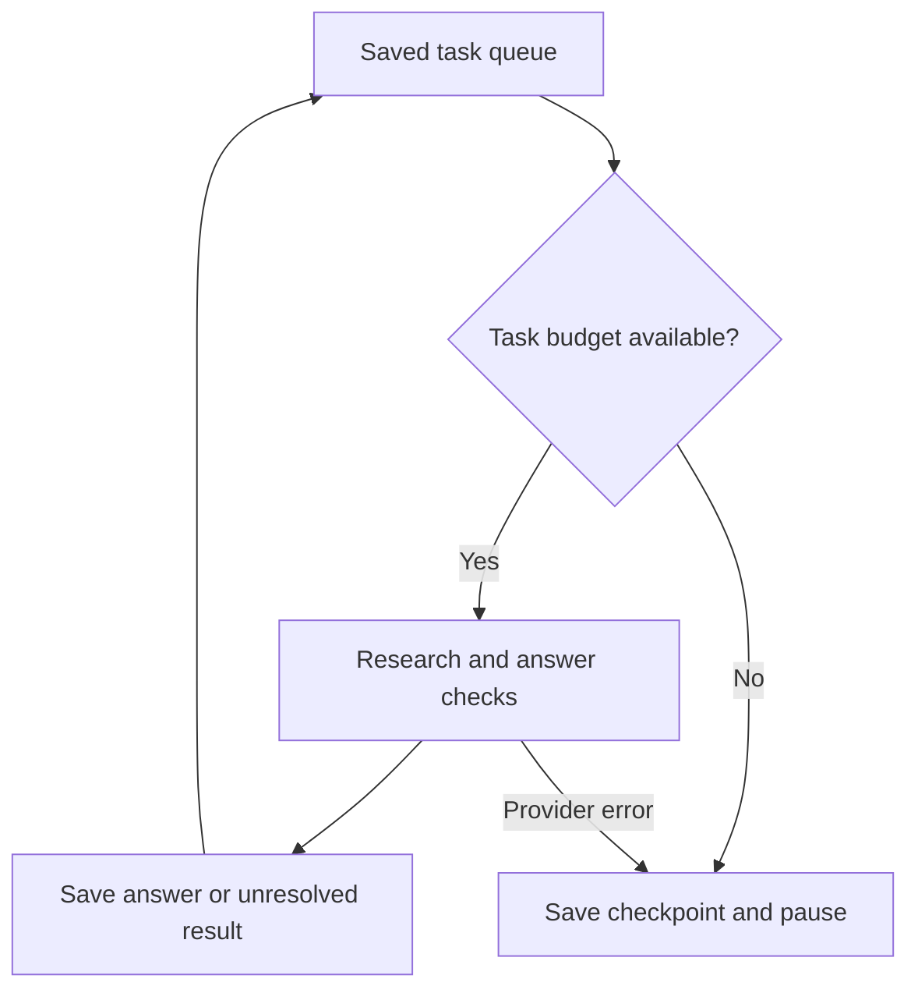

# Evaluation runner: budgets, saved results, and honest coverage

Updated 2026-11-17. This version runs the research profile; model-only comparison and additional input readers remain later work.

## What it does

The runner saves a fixed question snapshot, model/search choices, request limits, and fingerprints of the implementation and dependency lock. Each session works through unfinished tasks. Completed answers and terminal failures are skipped on resume; tasks interrupted by provider errors or a stopped process are retried from their question, with prior attempts retained. It does not yet resume from the middle of an agent conversation.

All tasks remain in the report. The current profile marks attachments and YouTube inputs unsupported before spending model requests. An answered task means the agent produced a response that passed its format/provenance checks; correctness requires separate grading.



## Initial preparation

The live course endpoint was read on 2026-11-17. Preparing and exporting the snapshot made no Gemini requests.

| Item | Prepared state |
| --- | --- |
| Evaluation name | `gaia_baseline_v1` |
| Model / search | Gemini 3.5 Flash-Lite / Serper |
| Total tasks | 20 |
| Pending text-delivered tasks | 13 |
| Unsupported inputs | 7: five attachments and two videos |
| Answers prepared | 0 |
| Model requests used | 0 |
| Official score | Unmeasured |

The [preparation summary](../examples/evaluation_prepared.json) contains the snapshot/profile fingerprints and counts, without publishing the questions or generated answers. The complete local snapshot is under the ignored `evaluations/gaia_baseline_v1/` folder.

## First live batch

A subsequent live session processed one task with an eight-request cap. It prepared one answer using seven requests, then stopped at the one-task limit. The saved queue now has one answered task, twelve pending text tasks, and seven unsupported inputs. The answer passed the agent's format/provenance checks but has not been officially graded. This is not an accuracy result.

The [partial-session summary](../examples/evaluation_session_summary.json) records the request count and queue coverage without publishing benchmark answers. The local draft export was refreshed after this session. No leaderboard submission was made.

## Run one bounded batch

The evaluation above is already prepared in the owner's working project. Inspect it without contacting a model:

```powershell
uv run python -m traceagent eval status --name gaia_baseline_v1
```

Start or resume one task with at most eight model-request attempts:

```powershell
uv run python -m traceagent eval run --name gaia_baseline_v1 --request-budget 8 --max-tasks 1 --diagnose
```

The model and search backend come from the saved profile, so shell model changes do not silently mix configurations. The eight-call per-task limit includes the optional answer correction. Before starting a task, the runner requires enough remaining session budget for its full per-task allowance. It may leave some of the session budget unused rather than interrupt a task halfway through its allowed calls.

A request hook persists a conservative reservation before each SDK HTTP attempt. Failed requests count against the local session budget. SDK transport retries, automatic function execution, and automatic response continuation are disabled. HTTP 429, other provider failures, or search authentication/quota failures stop the queue. No automatic model switch or background retry occurs. The local budget does not reveal the provider's remaining quota, and other applications may use the same project.

Each `eval run` invocation starts a new budgeted session. Previous reservations remain in the history, but do not automatically reduce the newly chosen session budget. Choose that budget using the project's current available allowance; the runner does not infer a daily reset from the local clock.

## Prepare a new evaluation

Use a new name when changing model, tool behavior, code, or limits:

```powershell
uv run python -m traceagent eval prepare --name gaia_baseline_v2 --model gemini-3.5-flash-lite --search-backend serper --max-calls-per-task 8
```

Preparation fetches the public questions only, keeps no answer/annotation fields, and never overwrites an existing snapshot. Code or lock-file changes prevent resuming an old run with a different implementation. Historical status and exports remain readable.

## Saved task states

| State | Meaning | Next session |
| --- | --- | --- |
| `pending` | No attempt yet | Eligible to run |
| `running` | In-flight task | Recovered as interrupted after a process exit |
| `retryable_error` | Provider/quota/local interruption | Retry from the question, retaining old attempts |
| `answered` | Format/provenance checks passed | Skip; correctness still ungraded |
| `unresolved` | No supported answer within the fixed policy/budget | Skip; keep the failure in the report |
| `unsupported` | Input reader not implemented | Skip; keep the task in the denominator |

Checkpoints use atomic JSON replacement and an OS lock to prevent concurrent writers to the same evaluation. Request reservations are written before dispatch, so an interrupted process does not reset that session's consumed budget.

## Export and grading

```powershell
uv run python -m traceagent eval export --name gaia_baseline_v1
```

This writes `answers.json` with one `{task_id, submitted_answer}` entry for every task, and a separate `report.json` with coverage, profile fingerprints, and an unmeasured score. Unsupported or unfinished tasks retain empty answers. An unfinished export is marked draft in the report. Export does not post to the leaderboard.

The [course instructions](https://huggingface.co/learn/agents-course/en/unit4/hands-on) require exact-match answer strings and a public Hugging Face Space code link for submission. This runner prepares the answers component; public Space deployment and official score submission are later steps. Prepared-answer coverage must never be reported as accuracy.

## Verification

79 automated tests pass locally, including actual SDK calls over mocked HTTP transport. Evaluation tests verify durable pre-request reservations, hard request limits, HTTP 429/503 queue stops, interruption recovery, completed-task skipping, snapshot/configuration integrity, writer locking, and full-denominator exports. A separate transport test verifies that an SDK continuation token cannot trigger hidden follow-up requests. Automated tests consume no external model/search quota.
