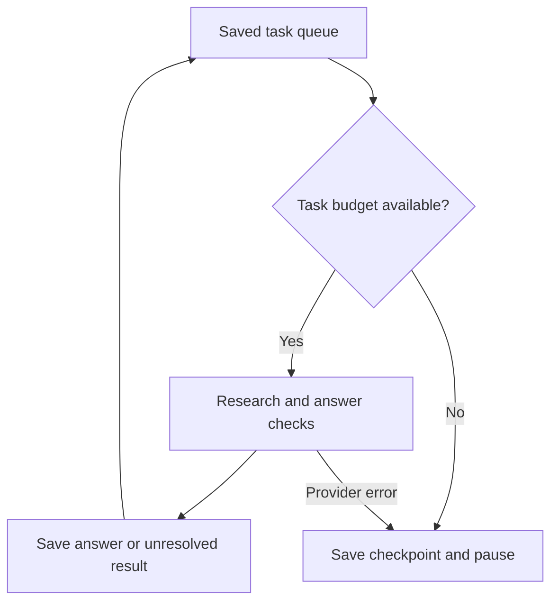

# Evaluation runner: budgets, saved results, and honest coverage

Updated 2026-11-17. This version runs the research profile; model-only comparison and additional input readers remain later work.

## What it does

The runner saves a fixed question snapshot, model/search choices, request limits, and fingerprints of the implementation and dependency lock. Each session works through unfinished tasks. Completed answers and terminal failures are skipped on resume; tasks interrupted by provider errors or a stopped process are retried from their question, with prior attempts retained. It does not yet resume from the middle of an agent conversation.

All tasks remain in the report. The current profile marks attachments and YouTube inputs unsupported before spending model requests. An answered task means the agent produced a response that passed its format/provenance checks; correctness requires separate grading.



## Source audit and replacement run

On 2026-11-17, a review of the second `gaia_baseline_v1` attempt found that the agent had opened a course dataset containing question/answer rows and cited an answer row. The prompt already prohibited solution lookup, but that instruction did not enforce the boundary. The research profile also required an external citation for a self-contained reasoning question, creating unnecessary searches.

`gaia_baseline_v1` is **invalidated for scoring**. It contains two prepared answers, eleven pending tasks, seven unsupported tasks, and eleven model-request attempts. Those historical attempts, answers, sources, and usage are preserved. An appended audit finding prevents further runs; exports withhold all answers and report `integrity_status: invalidated`. Nothing was submitted for official grading. The [source-audit summary](../examples/evaluation_source_audit.json) publishes counts and the finding without benchmark answers.

The revised policy has two parts:

- For a self-contained calculation or text/reasoning problem, the agent can cite `Q1`, the supplied question, and answer without web access. The record labels this evidence `question`, separate from independent web sources. Quotation checks still do not establish whether its reasoning is correct.
- During evaluation, tools exclude Hugging Face dataset/Space URLs and recognizable benchmark repositories, solution queries, answer-bearing search snippets, and answer tables. Requested URLs and final redirect destinations are screened; parsed document text is screened before passages enter the model context or source cache. Only event types are recorded for withheld content. Normal research can still consult legitimate dataset documentation.

These filters use conservative URL and text heuristics. They may exclude useful material or miss an unmarked solution. They cannot remove knowledge already present in a model. Source review and fresh non-benchmark tasks remain necessary; `not_audited` is not a certification of independence.

`gaia_baseline_v2` was prepared from the same question-only snapshot, with a new implementation/profile fingerprint. No old answers or observations were carried into it, and preparation used no model or search requests. It starts with thirteen pending text tasks, seven unsupported tasks, and zero generated answers. Its first live task has now prepared one ungraded answer using eight model requests and seven tool calls. Twelve tasks remain pending and seven remain unsupported. Source inspection found Wikipedia pages and a matching excerpt in the requested table; it found no benchmark solution material in that attempt. The task did not exercise a live source-filter block or supplied-question reasoning. The [v2 session summary](../examples/evaluation_v2_session_summary.json) records the results without publishing the question or answer. Four similar searches preceded the first page read, and a fifth search was blocked; a focused reread recovered the relevant evidence. Record this efficiency issue for a later version without changing the frozen implementation midway.

## Second v2 task: format and reasoning failure

The next supported task used no web or arithmetic tools. It selected supplied-question evidence, but its final JSON contained unescaped quotation marks inside an evidence string. Both the initial response and its one allowed correction failed parsing; only the last candidate is archived, so the exact defect of the initial response is not established. The final explanation also applied an additional output transformation that the question did not request. A JSON-only output constraint would address serialization, not guarantee correct reasoning.

This attempt remains unresolved. It used two model requests, zero tool calls, and one correction. Across v2, ten request attempts have now produced one prepared answer, one unresolved task, eleven pending tasks, and seven unsupported inputs. No official score is available. The original candidates and task states were not rewritten, and the implementation/profile remain frozen. The [failure summary](../examples/evaluation_v2_format_failure_summary.json) records the findings without publishing the question or candidate answer. Finish the baseline before comparing a revised output/reasoning policy in a new evaluation.

## Historical initial preparation

The live course endpoint was read on 2026-11-17. Preparing and exporting the snapshot made no Gemini requests.

| Item | Prepared state |
| --- | --- |
| Evaluation name | `gaia_baseline_v1` |
| Model / search | Gemini 3.5 Flash-Lite / Serper |
| Total tasks | 20 |
| Pending text-delivered tasks | 13 |
| Unsupported inputs | 7: five attachments and two videos |
| Answers prepared | 0 |
| Model requests used | 0 |
| Official score | Unmeasured |

The [preparation summary](../examples/evaluation_prepared.json) contains the snapshot/profile fingerprints and counts, without publishing the questions or generated answers. The complete local snapshot is under the ignored `evaluations/gaia_baseline_v1/` folder.

## First live batch

A first live session processed one task with an eight-request cap. It prepared one answer using seven requests, then stopped at the one-task limit. At that point the queue had one answered task, twelve pending text tasks, and seven unsupported inputs. A later source audit invalidated the evaluation, as described above. This historical batch is not an accuracy result.

The [partial-session summary](../examples/evaluation_session_summary.json) records the request count and queue coverage without publishing benchmark answers. The local draft export was refreshed after this session. No leaderboard submission was made.

## Run one bounded batch

The replacement evaluation is already prepared in the owner's working project. Inspect it without contacting a model:

```powershell
uv run python -m traceagent eval status --name gaia_baseline_v2
```

Start or resume one task with at most eight model-request attempts:

```powershell
uv run python -m traceagent eval run --name gaia_baseline_v2 --request-budget 8 --max-tasks 1 --diagnose
```

The model and search backend come from the saved profile, so shell model changes do not silently mix configurations. The eight-call per-task limit includes the optional answer correction. Before starting a task, the runner requires enough remaining session budget for its full per-task allowance. It may leave some of the session budget unused rather than interrupt a task halfway through its allowed calls.

A request hook persists a conservative reservation before each SDK HTTP attempt. Failed requests count against the local session budget. SDK transport retries, automatic function execution, and automatic response continuation are disabled. HTTP 429, other provider failures, or search authentication/quota failures stop the queue. No automatic model switch or background retry occurs. The local budget does not reveal the provider's remaining quota, and other applications may use the same project.

Each `eval run` invocation starts a new budgeted session. Previous reservations remain in the history, but do not automatically reduce the newly chosen session budget. Choose that budget using the project's current available allowance; the runner does not infer a daily reset from the local clock.

## Prepare a new evaluation

In a fresh checkout, prepare the current profile once. Use another new name for later changes to model, tool behavior, code, or limits:

```powershell
uv run python -m traceagent eval prepare --name gaia_baseline_v2 --model gemini-3.5-flash-lite --search-backend serper --max-calls-per-task 8
```

Preparation fetches the public questions only, keeps no answer/annotation fields, and never overwrites an existing snapshot. Code or lock-file changes prevent resuming an old run with a different implementation. Historical status and exports remain readable.

## Saved task states

| State | Meaning | Next session |
| --- | --- | --- |
| `pending` | No attempt yet | Eligible to run |
| `running` | In-flight task | Recovered as interrupted after a process exit |
| `retryable_error` | Provider/quota/local interruption | Retry from the question, retaining old attempts |
| `answered` | Format/provenance checks passed | Skip; correctness still ungraded |
| `unresolved` | No supported answer within the fixed policy/budget | Skip; keep the failure in the report |
| `unsupported` | Input reader not implemented | Skip; keep the task in the denominator |

Checkpoints use atomic JSON replacement and an OS lock to prevent concurrent writers to the same evaluation. Request reservations are written before dispatch, so an interrupted process does not reset that session's consumed budget.

## Export and grading

```powershell
uv run python -m traceagent eval export --name gaia_baseline_v2
```

This writes `answers.json` with one `{task_id, submitted_answer}` entry for every task, and a separate `report.json` with coverage, profile fingerprints, source-audit status, and an unmeasured score. Unsupported or unfinished tasks retain empty answers. Invalidated evaluations export empty answers for every task, while retaining their original candidates in their checkpoint and run records. An unfinished or invalidated export is marked draft. Export does not post to the leaderboard.

The [course instructions](https://huggingface.co/learn/agents-course/en/unit4/hands-on) require exact-match answer strings and a public Hugging Face Space code link for submission. This runner prepares the answers component; public Space deployment and official score submission are later steps. Prepared-answer coverage must never be reported as accuracy.

## Verification

89 automated tests pass locally, including actual SDK calls over mocked HTTP transport. Evaluation tests verify durable pre-request reservations, hard request limits, HTTP 429/503 queue stops, interruption recovery, completed-task skipping, snapshot/configuration integrity, writer locking, and full-denominator exports. New tests check that fake answer labels cannot enter follow-up model observations or saved source records, excluded URLs/redirects are refused, invalidation preserves history and withholds exports, and supplied-input reasoning can finish with one model response and no web calls. A separate transport test verifies that an SDK continuation token cannot trigger hidden follow-up requests. Automated tests consume no external model/search quota.
