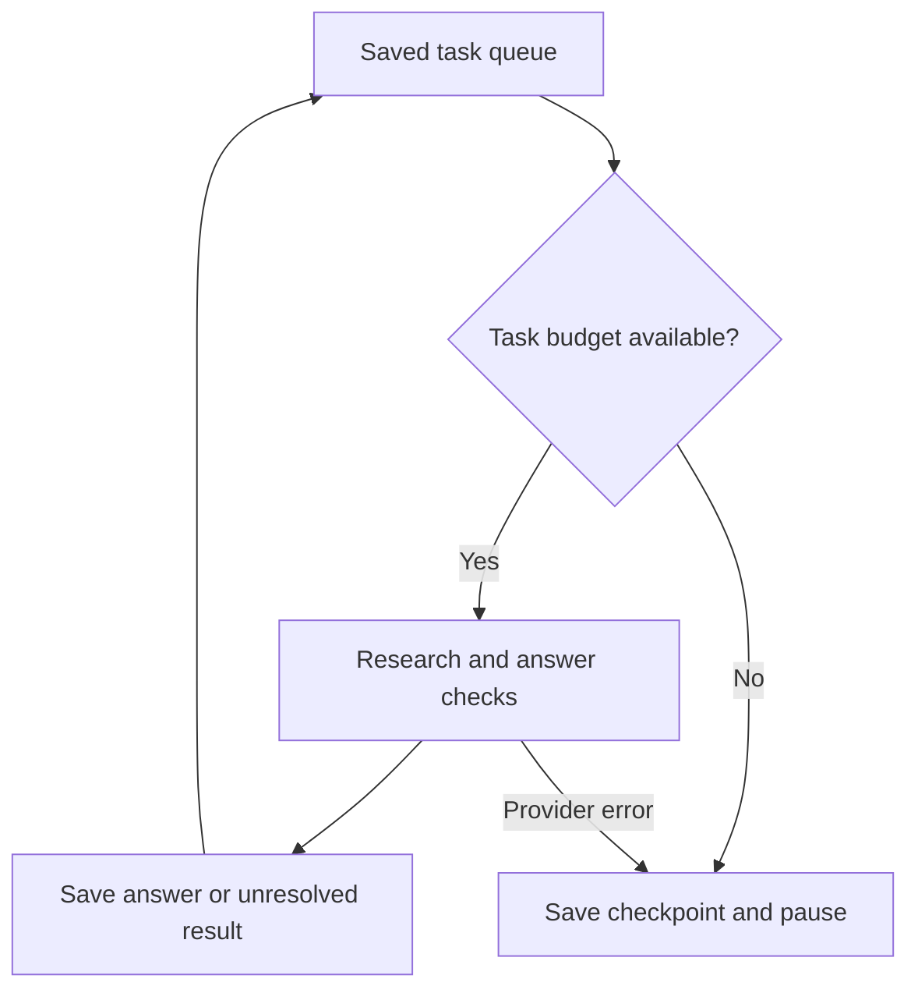

# Evaluation runner: budgets, saved results, and honest coverage

Updated 2026-11-17. This version runs the research profile; model-only comparison and additional input readers remain later work.

## What it does

The runner saves a fixed question snapshot, model/search choices, request limits, and fingerprints of the implementation and dependency lock. Each session works through unfinished tasks. Completed answers and terminal failures are skipped on resume; tasks interrupted by provider errors or a stopped process are retried from their question, with prior attempts retained. It does not yet resume from the middle of an agent conversation.

All tasks remain in the report. The current profile marks attachments and YouTube inputs unsupported before spending model requests. An answered task means the agent produced a response that passed its format/provenance checks; correctness requires separate grading.



## Current profile: v4 source screening

The third v3 task returned a candidate after seven requests and one opened Wikipedia source. Its quoted text matched, but review of **search snippets** found a course walkthrough repeating the question and part of its lookup strategy. An answer-solver result and a research-paper task example also reproduced the task. The model sees those snippets even when it never opens their pages. No final answer was visible in the walkthrough snippets, and this is not proof of direct final-label copying. Independent execution is uncertain, so v3 is conservatively excluded from scoring. Its two candidates, one unresolved task, ten pending tasks, seven unsupported inputs, and fourteen request attempts remain preserved. Its exports now withhold all answers and its runner refuses continuation.

The cited Wikipedia roundup also covers a wider time interval than the question requests; the quoted attribution alone does not establish the requested month or uniqueness. This is a separate evidence-completeness limitation. Quote membership must never be presented as full factual validation.

V4 keeps the same model/search backend, eight-model-request cap, twelve-tool cap, four-search cap, finalization, correction, and quote checks. It adds general source-policy rules rather than answers or task-specific lookup instructions:

- Exclude recognizable Agents Course/unit-four context, even when no answer/solution keyword occurs.
- Exclude task-goal metadata and sources repeating ten consecutive question words after case, punctuation, Unicode, and URL normalization. Screen URLs, titles/snippets, parsed documents, and outgoing links before exposure.
- Exclude Medium, LinkedIn, Reddit, and Wordplays, including their subdomains, in benchmark mode. Ordinary research can still use these sites. This trades source coverage for a more conservative evaluation boundary.

Tests use a fabricated bridge-design question and fake labels, not benchmark answers. They verify pre-download URL screening, filtered search caches, document/link screening, host boundaries, normal-research access, and absence of withheld labels in follow-up model observations and saved records. An offline replay of this actual run excluded five of six retained search observations while leaving the Wikipedia source available. That demonstrates this specific gap is addressed, not universal leak detection.

The [v4 preparation summary](../examples/evaluation_v4_prepared.json) contains counts, policy, fingerprints, and the audit finding without publishing benchmark questions or answers. The new snapshot has thirteen pending tasks, seven unsupported inputs, and zero generated answers/requests. No old candidates or observations were carried over. The first live task has now prepared one ungraded answer, as described below. Heuristics can miss paraphrases or reject legitimate sources; pretrained knowledge and development on a public validation subset remain limitations. Fresh questions and ongoing trace review are still needed.

## First live v4 task

The first v4 task prepared one ungraded answer with six model requests, five tool calls (four searches and one focused read), 15,171 input tokens, 15,438 total tokens, and 22.994 seconds. Review covered the returned search snippets as well as the opened source. No task-specific walkthrough or answer-key material was observed. The cited Wikipedia discography excerpt contains the matching quoted rows. The [session summary](../examples/evaluation_v4_session_summary.json) records the observations without the question or answer.

All six responses were normal turns: neither reserved finalization nor correction was exercised, and no source-filter block occurred. Four similar searches still preceded opening the source, so planning efficiency remains an issue. This single run does not establish general accuracy or universal leak prevention. V4 has one prepared answer, twelve pending tasks, and seven unsupported inputs. The refreshed draft export retains twenty rows, with one non-empty answer; official grading remains unmeasured. The implementation/profile remain unchanged.

## Second live v4 task: checks pass, reasoning concern remains

A self-contained task initially failed quote verification. Its one structured correction returned valid JSON and a Q1 quote matching the supplied text, so the controller recorded `answered`. The attempt used two model requests, zero tools, 1,851 input tokens, 2,061 total tokens, and 2.821 seconds. There was no web exposure. The initial candidate is not archived; only its failed validation event and the final corrected candidate are available.

Manual review found that the response applies an additional reversal to its final answer that the instruction does not request. This is a reasoning issue despite passed format/provenance checks. The candidate and `answered` state are preserved for faithful baseline grading; no replacement answer or selected rerun is inserted. The [reasoning-review summary](../examples/evaluation_v4_reasoning_review.json) records the finding without the question or candidate answer.

After that attempt, V4 had two prepared candidates, eleven pending tasks, and seven unsupported inputs after eight requests. These are coverage states, not measured correct answers. Official grading remains unmeasured, and reserved finalization remains unobserved live. The implementation/profile are unchanged while other supported tasks are evaluated.

## Third live v4 task: primary archive evidence

The third task prepared a candidate using seven model requests, six tool calls (four searches and two reads), 31,128 input tokens, 31,462 total tokens, and 17.412 seconds. All returned search observations and opened sources were Wikipedia pages. The primary nomination archive contains the requested promotion date and the attribution quoted in the final response. One search result was filtered before exposure; its withheld content is not archived. No task-specific walkthrough or answer-key material was observed in returned snippets or opened pages. See the [source-review summary](../examples/evaluation_v4_research_review.json), which omits the benchmark question and answer.

The monthly archive extraction is truncated; an exhaustive uniqueness check is not established by this review. All seven model turns were normal: reserved finalization and correction were not used. V4 has three generated candidates, ten pending tasks, and seven unsupported inputs after fifteen request attempts. The earlier self-contained candidate still has a manual reasoning flag. These are coverage states, not an official correctness count. The implementation/profile remain unchanged, and the refreshed draft export retains all twenty tasks.

## Fourth through sixth v4 tasks: reasoning and retrieval limits

A later review of the fourth generated candidate compared every pair in its supplied operation table using a deterministic calculation. Its final answer field disagrees with that check, despite passing format/quote verification. The original candidate remains preserved for grading. This adds a second manual reasoning flag; four prepared candidates must not be presented as four correct answers.

The following task encountered a transport failure, then its explicit retry used eight requests, four successful searches, two reads of the same exercise page, and one blocked extra search. The page belongs to a General/Organic/Biochemistry course; its correspondence to the compilation/edition requested by the question is not established. Both retained excerpts were truncated and lacked the focus terms. The reserved eighth request had tools removed and returned valid structured `unresolved` output. This is the first inspected live finalizer observation. It does not prove absence of the fact from the full requested source.

The sixth task received usable URLs in four successful searches but never opened them. Three further search attempts were blocked by the exhausted-search guard. The reserved final request returned structured JSON claiming a source ID that had never been created. Its quotation matches an unopened search snippet. Local evidence validation rejected the candidate, with no request budget left for a correction. This demonstrates a planning/source-use failure and successful rejection of unsupported provenance; it does not establish factual correctness of the generated list.

The [combined failure review](../examples/evaluation_v4_failure_review.json) records these findings without questions, candidate answers, or derived benchmark labels. Original records, generated candidates, terminal failures, prior provider failures, and request reservations remain unchanged. At that checkpoint, V4 had four prepared candidates, two unresolved tasks, seven pending tasks, and seven unsupported inputs after thirty-five request attempts. The refreshed export retains twenty rows; official accuracy remains unmeasured.

Continue the fixed profile across remaining supported tasks. A later revision can evaluate exhausted-tool controls, allowed citation IDs, source/edition matching, and consistency between computed results and final answer fields. Those changes are not mixed into v4 midway.

## Seventh v4 task: partial multi-hop evidence chain

The next task prepared a candidate using four model requests, three tool calls (two searches and one page read), 10,651 input tokens, 10,880 total tokens, and 9.07 seconds. Its final role quote matches the opened actor biography, which also lists the role in the other show. The bridge identifying that show as the adaptation of the original series was provided by a search snippet, and the adaptation page was not opened. This is a partial evidence-chain limitation rather than established full-chain provenance. The requested first-name-only format was followed, and no task-specific walkthrough/answer-key material was observed in returned search observations. One result was filtered before exposure.

The [multi-hop review](../examples/evaluation_v4_multihop_review.json) omits the benchmark question and candidate answer. All four model turns were normal, with no correction or reserved finalization. The candidate remains preserved with its review limitation. After that attempt, V4 had five generated candidates, two unresolved tasks, six pending tasks, and seven unsupported inputs after thirty-nine request attempts. Two earlier candidates retain manual reasoning flags. Official grading remains unmeasured, and the fixed implementation/profile are unchanged.

## Eighth v4 task: source refusal and weak fallback planning

A source read returned HTTP 403. The first search had already provided another source URL, and later results included an official league page and additional alternatives, but the model opened none of them. It repeatedly searched the inaccessible source, used four actual searches, and made two further search attempts that were locally blocked. No citable source was created. The reserved finalizer returned structured unresolved output within the original eight-request cap.

The run used eight model requests, seven tool calls, 15,466 input tokens, 15,778 total tokens, and 15.545 seconds. A returned agent-research paper snippet included a related lookup query/table description; it was not opened and no answer was accepted. This is a documented source-screening limitation, not a verified independent solved result. The task remains empty/unresolved for scoring. A new conversation is used for each subsequent task. The [source-access review](../examples/evaluation_v4_source_access_review.json) records observations without the question, target entities, or answer.

V4 now has five generated candidates, three unresolved tasks, five pending tasks, and seven unsupported inputs after forty-seven request attempts. The two earlier manual reasoning flags remain. Continue the fixed profile; accessible-source fallback, exhausted-tool availability, and paraphrased agent-trace screening are later improvement targets. No official accuracy is measured.

## Historical v3 controller design

V2 is paused as an **incomplete, ungraded baseline** after three supported tasks reached terminal states. Twenty request attempts produced one prepared answer and two unresolved tasks; ten tasks remain pending and seven inputs unsupported. The last retry exhausted eight model calls while still selecting tools, after opening a directly relevant source. One focused archive read returned an excerpt with no matching focus term. These observations justify general controller changes before spending further free-tier quota. Original task states, answers, records, and usage remain preserved. This is not a completed full-set baseline or an accuracy comparison.

V3 retains the same model, search backend, twenty-question snapshot, eight-model-request cap, twelve-tool cap, and four-search cap. It carries over no answers or observations. Its revised behavior is:

| Request phase | Model controls | Budget behavior |
| --- | --- | --- |
| Gather evidence | Research tools available; open relevant results before repeating searches | Uses the original task/session allowance |
| Reserved finish | Tool declarations removed; JSON response schema supplied; answer or unresolved from retained evidence | Uses the final permitted request, with no allowance increase |
| One correction | Same schema and no tools; precise validation feedback | Available only if a request remains within the cap |

The controller also finalizes when the completed-tool count reaches its cap. It refuses a tool request during finalization, rejects truncated outputs, and continues to check source/quote membership locally. The finalization phase does not guarantee a correct answer or overcome missing evidence. Tool-selection turns can still return a final response early; if its format fails, the single correction requests structured JSON.

[Google's structured-output documentation](https://aistudio.google.com/docs/structured-output) distinguishes response schemas from factual validation. The installed Google SDK exposes `response_mime_type` and `response_json_schema`; transport-backed tests verify that the correct fields are sent by `generate_content`. Schema requests are limited to turns without tool declarations. The [current model documentation](https://aistudio.google.com/docs/models/gemini-3.5-flash-lite) lists structured-output support, but reserved finalization still needs live observation. A structured correction has now returned parseable JSON in a live task, while its changed quotation marks failed evidence verification.

Read results now list matched focus terms and warn when none occur in retained passages. This does not extend document limits or fix every extraction/truncation issue. A provider failure records its exception class name without raw exception text. The terminal displays per-task status/reason and diagnostic categories, avoiding a generic queue summary as the only explanation.

The local `gaia_baseline_v3` snapshot is prepared with thirteen pending tasks, seven unsupported inputs, zero generated answers, and zero requests. The [v3 preparation summary](../examples/evaluation_v3_prepared.json) publishes profile/fingerprint/count information only. Preparation and offline tests used no live model/search requests. Historical status/exports remain readable; resuming an old evaluation requires its recorded implementation rather than mixing controller versions.

## First live v3 task

The first v3 task prepared one ungraded answer using five model requests, four tool calls (three searches and one focused page read), 12,042 input tokens, 12,314 total tokens, and 18.79 seconds. Source review confirmed an opened Wikipedia page with the requested table and matching quoted rows; no benchmark solution material was observed in the trace. The saved draft export has all twenty rows, with one non-empty answer. Twelve tasks remain pending and seven inputs unsupported. See the [session summary](../examples/evaluation_v3_session_summary.json), which omits the benchmark question and answer.

The earlier v2 attempt on the same task used eight requests, seven tools, and 81.115 seconds. This is a single observed comparison: generation and service conditions vary, and the run does not establish general efficiency or accuracy gains. Three similar searches still preceded opening a source already present in the first result set. All five v3 responses were normal turns; the reserved last-request finalizer and schema correction were not exercised. The second task below now documents structured correction; reserved finalization remains unobserved live. Official grading remains unmeasured, and the frozen implementation is unchanged.

## Second v3 task: parseable correction, rejected evidence

The next supported task made no tool calls. Its first response failed JSON parsing; the single structured correction returned parseable JSON, providing a live observation of the schema-correction branch. The final quote replaced double quotation marks in the supplied input with apostrophes. That excerpt is not verbatim, so the provenance checker rejected it. The response also treated the input presentation as an extra required output transformation. Only the final candidate is archived, so the exact initial formatting defect is not established. These are separate format, evidence, and reasoning findings.

The task remains unresolved with its original candidate and failed checks retained. It used two model requests and one correction. V3 now has one prepared answer, one unresolved task, eleven pending tasks, and seven unsupported inputs after seven request attempts. There has been no official grading. The [evidence-failure summary](../examples/evaluation_v3_evidence_failure_summary.json) records the observations without the benchmark question or answer. The implementation remains frozen while other supported tasks are evaluated; changes to input evidence handling or reasoning will need a separately versioned comparison. Reserved finalization remains unobserved live.

## Source audit and replacement run

On 2026-11-17, a review of the second `gaia_baseline_v1` attempt found that the agent had opened a course dataset containing question/answer rows and cited an answer row. The prompt already prohibited solution lookup, but that instruction did not enforce the boundary. The research profile also required an external citation for a self-contained reasoning question, creating unnecessary searches.

`gaia_baseline_v1` is **invalidated for scoring**. It contains two prepared answers, eleven pending tasks, seven unsupported tasks, and eleven model-request attempts. Those historical attempts, answers, sources, and usage are preserved. An appended audit finding prevents further runs; exports withhold all answers and report `integrity_status: invalidated`. Nothing was submitted for official grading. The [source-audit summary](../examples/evaluation_source_audit.json) publishes counts and the finding without benchmark answers.

The revised policy has two parts:

- For a self-contained calculation or text/reasoning problem, the agent can cite `Q1`, the supplied question, and answer without web access. The record labels this evidence `question`, separate from independent web sources. Quotation checks still do not establish whether its reasoning is correct.
- During evaluation, tools exclude Hugging Face dataset/Space URLs and recognizable benchmark repositories, solution queries, answer-bearing search snippets, and answer tables. Requested URLs and final redirect destinations are screened; parsed document text is screened before passages enter the model context or source cache. Only event types are recorded for withheld content. Normal research can still consult legitimate dataset documentation.

These filters use conservative URL and text heuristics. They may exclude useful material or miss an unmarked solution. They cannot remove knowledge already present in a model. Source review and fresh non-benchmark tasks remain necessary; `not_audited` is not a certification of independence.

`gaia_baseline_v2` was prepared from the same question-only snapshot, with a new implementation/profile fingerprint. No old answers or observations were carried into it, and preparation used no model or search requests. It starts with thirteen pending text tasks, seven unsupported tasks, and zero generated answers. Its first live task has now prepared one ungraded answer using eight model requests and seven tool calls. Twelve tasks remain pending and seven remain unsupported. Source inspection found Wikipedia pages and a matching excerpt in the requested table; it found no benchmark solution material in that attempt. The task did not exercise a live source-filter block or supplied-question reasoning. The [v2 session summary](../examples/evaluation_v2_session_summary.json) records the results without publishing the question or answer. Four similar searches preceded the first page read, and a fifth search was blocked; a focused reread recovered the relevant evidence. Record this efficiency issue for a later version without changing the frozen implementation midway.

## Second v2 task: format and reasoning failure

The next supported task used no web or arithmetic tools. It selected supplied-question evidence, but its final JSON contained unescaped quotation marks inside an evidence string. Both the initial response and its one allowed correction failed parsing; only the last candidate is archived, so the exact defect of the initial response is not established. The final explanation also applied an additional output transformation that the question did not request. A JSON-only output constraint would address serialization, not guarantee correct reasoning.

This attempt remains unresolved. It used two model requests, zero tool calls, and one correction. Across v2, ten request attempts have now produced one prepared answer, one unresolved task, eleven pending tasks, and seven unsupported inputs. No official score is available. The original candidates and task states were not rewritten, and the implementation/profile remain frozen. The [failure summary](../examples/evaluation_v2_format_failure_summary.json) records the findings without publishing the question or candidate answer. A subsequent control-loop failure led to preserving v2 as a partial baseline and preparing v3, as described above.

## Historical initial preparation

The live course endpoint was read on 2026-11-17. Preparing and exporting the snapshot made no Gemini requests.

| Item | Prepared state |
| --- | --- |
| Evaluation name | `gaia_baseline_v1` |
| Model / search | Gemini 3.5 Flash-Lite / Serper |
| Total tasks | 20 |
| Pending text-delivered tasks | 13 |
| Unsupported inputs | 7: five attachments and two videos |
| Answers prepared | 0 |
| Model requests used | 0 |
| Official score | Unmeasured |

The [preparation summary](../examples/evaluation_prepared.json) contains the snapshot/profile fingerprints and counts, without publishing the questions or generated answers. The complete local snapshot is under the ignored `evaluations/gaia_baseline_v1/` folder.

## First live batch

A first live session processed one task with an eight-request cap. It prepared one answer using seven requests, then stopped at the one-task limit. At that point the queue had one answered task, twelve pending text tasks, and seven unsupported inputs. A later source audit invalidated the evaluation, as described above. This historical batch is not an accuracy result.

The [partial-session summary](../examples/evaluation_session_summary.json) records the request count and queue coverage without publishing benchmark answers. The local draft export was refreshed after this session. No leaderboard submission was made.

## Run one bounded batch

The replacement evaluation is already prepared in the owner's working project. Inspect it without contacting a model:

```powershell
uv run python -m traceagent eval status --name gaia_baseline_v4
```

Start or resume one task with at most eight model-request attempts:

```powershell
uv run python -m traceagent eval run --name gaia_baseline_v4 --request-budget 8 --max-tasks 1 --diagnose
```

The model and search backend come from the saved profile, so shell model changes do not silently mix configurations. The eight-call per-task limit includes the optional answer correction. Before starting a task, the runner requires enough remaining session budget for its full per-task allowance. It may leave some of the session budget unused rather than interrupt a task halfway through its allowed calls.

A request hook persists a conservative reservation before each SDK HTTP attempt. Failed requests count against the local session budget. SDK transport retries, automatic function execution, and automatic response continuation are disabled. HTTP 429, other provider failures, or search authentication/quota failures stop the queue. No automatic model switch or background retry occurs. The local budget does not reveal the provider's remaining quota, and other applications may use the same project.

Each `eval run` invocation starts a new budgeted session. Previous reservations remain in the history, but do not automatically reduce the newly chosen session budget. Choose that budget using the project's current available allowance; the runner does not infer a daily reset from the local clock.

## Prepare a new evaluation

In a fresh checkout, prepare the current profile once. Use another new name for later changes to model, tool behavior, code, or limits:

```powershell
uv run python -m traceagent eval prepare --name gaia_baseline_v4 --model gemini-3.5-flash-lite --search-backend serper --max-calls-per-task 8
```

Preparation fetches the public questions only, keeps no answer/annotation fields, and never overwrites an existing snapshot. Code or lock-file changes prevent resuming an old run with a different implementation. Historical status and exports remain readable.

## Saved task states

| State | Meaning | Next session |
| --- | --- | --- |
| `pending` | No attempt yet | Eligible to run |
| `running` | In-flight task | Recovered as interrupted after a process exit |
| `retryable_error` | Provider/quota/local interruption | Retry from the question, retaining old attempts |
| `answered` | Format/provenance checks passed | Skip; correctness still ungraded |
| `unresolved` | No supported answer within the fixed policy/budget | Skip; keep the failure in the report |
| `unsupported` | Input reader not implemented | Skip; keep the task in the denominator |

Checkpoints use atomic JSON replacement and an OS lock to prevent concurrent writers to the same evaluation. Request reservations are written before dispatch, so an interrupted process does not reset that session's consumed budget.

## Export and grading

```powershell
uv run python -m traceagent eval export --name gaia_baseline_v4
```

This writes `answers.json` with one `{task_id, submitted_answer}` entry for every task, and a separate `report.json` with coverage, profile fingerprints, source-audit status, and an unmeasured score. Unsupported or unfinished tasks retain empty answers. Invalidated evaluations export empty answers for every task, while retaining their original candidates in their checkpoint and run records. An unfinished or invalidated export is marked draft. Export does not post to the leaderboard.

The [course instructions](https://huggingface.co/learn/agents-course/en/unit4/hands-on) require exact-match answer strings and a public Hugging Face Space code link for submission. This runner prepares the answers component; public Space deployment and official score submission are later steps. Prepared-answer coverage must never be reported as accuracy.

## Verification

108 automated tests pass locally, including actual SDK calls over mocked HTTP transport. Evaluation tests verify durable pre-request reservations, hard request limits, HTTP 429/503 queue stops, interruption recovery, completed-task skipping, snapshot/configuration integrity, writer locking, and full-denominator exports. New tests check that fake answer labels cannot enter follow-up model observations or saved source records, excluded URLs/redirects are refused, invalidation preserves history and withholds exports, and supplied-input reasoning can finish with one model response and no web calls. A separate transport test verifies that an SDK continuation token cannot trigger hidden follow-up requests. Additional transport-backed tests verify the eighth-request finalization schema, removed tool declarations, preserved signatures/observations, correction of embedded quotes, refusal of finalization-time tool calls, truncation rejection, explicit unresolved results, safe timeout categories, and task-result output. Automated tests consume no external model/search quota.
