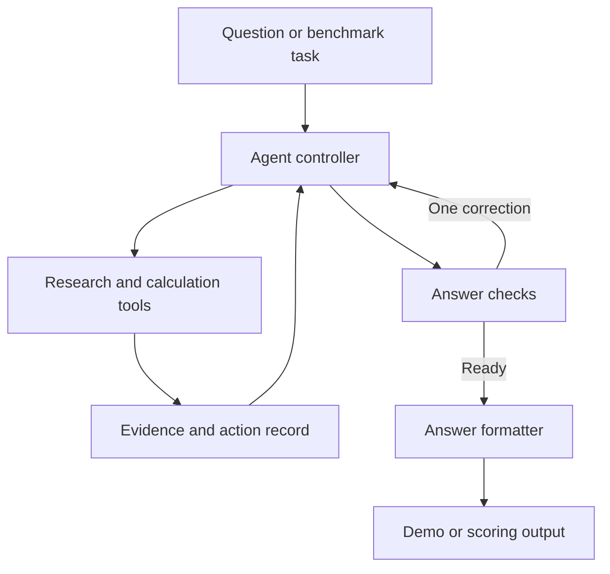

# TraceAgent: system design

Status: proposed full architecture with a working calculator and a live search/read/answer research path. Updated 2026-11-21. See [requirements](requirements.md) and the [research walkthrough](research_walkthrough.md) for scope and observed evidence.

## Purpose and ownership

TraceAgent will investigate factual questions using tools, retain the evidence used to answer them, and produce a concise answer. It will support both an interactive research demonstration and evaluation on the Hugging Face Agents Course's 20-question GAIA validation subset.

Habib directs the system requirements, architecture choices, capability priorities, evaluation design, and demonstration experience. Coding assistance handles implementation, integration, debugging, and automated tests. Reviews focus on what components do, why they exist, how data flows, and which tradeoffs the evaluation supports.

## Requirements

| Requirement | Intended behavior |
| --- | --- |
| Research | Search the web, read relevant pages, and use supplied documents when needed |
| Tool use | Select actions from the question and intermediate results; repeat when more evidence is needed |
| Evidence | Associate retrieved facts with URLs or file locations and tool calls |
| Answers | Show supporting sources in the demo; send only the requested answer to benchmark scoring |
| Reliability | Bound calls and timeouts, retain completed actions after failures, and report unresolved tasks |
| Cost | Use free service tiers and local processing; stop at quota limits without paid fallback |
| Evaluation | Report correctness, runtime, model/tool usage, and failure categories on a clearly identified task set |
| Reproducibility | Record model and tool configuration, questions, generated answers, and run metadata |

## Components and current status

| Component | Responsibility | Status |
| --- | --- | --- |
| Task intake | Accept the question, attachments, and required answer format | CLI question intake exists; attachment handling planned |
| Agent controller | Decide which tool to use, read results, and decide whether to continue | LangGraph model/tool loop implemented |
| Tool layer | Execute research, document-reading, and arithmetic functions | Multiply/add, web/text/PDF reading, and selectable search adapters implemented; live Serper search, HTML/PDF reading, and multiplication observed; attachment routing remains planned |
| Evidence record | Store source identifiers, excerpts or file locations, retrieval times, and related actions | Web source IDs, separate supplied-question evidence (Q1), and JSON records implemented |
| Answer checks | Check format constraints and review whether the evidence supports the proposed answer | JSON, source-ID, and quote-membership checks can guide one budgeted correction with tools disabled; factual entailment remains a review task |
| Answer formatter | Produce a useful demo response or a benchmark-only answer field | CLI evidence output and evaluation answer-only exports implemented |
| Evaluation runner | Run a fixed task set, save results, compare configurations, and prepare scoring submissions | Research-profile snapshots, bounded batches, task-level resume, and draft exports implemented; model-only comparison and official scoring pending |
| Demo interface | Let visitors ask questions and inspect sources, actions, and evaluation results | Gradio interface planned |

## Proposed data flow

The controller remains responsible for choosing the next action. Tools execute specific functions and return observations. The evidence record makes it possible to inspect the basis for an answer. Answer checks combine deterministic format validation with an evidence review; they reduce failures but do not guarantee factual correctness. The implemented review path allows one final-answer correction inside the existing model-call budget, using retained observations and a precise validation message. Tool calls are disabled for that correction. A second validation failure, a provider error, or exhausted budget ends the run. This corrects formatting/provenance failures without assuming the answer is factually correct.

## Initial design decisions

| Decision | Reason and implication |
| --- | --- |
| One agent controller | Establish a measurable baseline with a small number of moving parts; evaluate further architectural complexity against observed failures |
| Explicit Python tools | Separate model-selected actions from execution, validation, and result logging |
| Preserve full model messages | Keep protocol state, including Gemini function-call identifiers and thought signatures |
| Evidence per run | Make sources and actions inspectable; a shared retrieval database can be considered if document scale justifies it |
| Selectable search provider | Keep source discovery independent of reading/evidence checks; Serper is available after Tavily signup returned 403, with explicit configuration and no automatic provider switch |
| Distinct demo and scoring outputs | Let people inspect sources without adding explanation or citation text to an exact-match answer |
| Free-tier Gemini 3.6 Flash initially | A live model connection and multiplication loop succeeded; availability and quota remain service constraints |
| Bounded execution | Calculator runs permit four model calls and six tools; research permits eight model calls and twelve tools, including at most one final-answer correction |

## Failure behavior

Provider failures stop the current run without automatic transport retries or a paid fallback. The single final-answer correction applies to a completed model response that fails format/evidence checks, and it remains inside the model-call budget. Invalid tool arguments return structured errors so the controller can recover within its budget. Website and document contents are treated as retrieved data, not as permission to change system rules. Web tools enforce timeouts, content-size limits, and URL-access restrictions.

If the evidence is incomplete or contradictory, the agent should seek additional evidence within its budget, then report the unresolved task. An answer-checking model is not a substitute for external ground truth.

## Evaluation and portfolio evidence

1. Keep a model-only baseline and a tool-enabled configuration, documenting the inputs and capabilities available to each.
2. Snapshot the evaluated question set and record model IDs, tool configuration, budgets, generated answers, and run metadata.
3. Report the course subset's exact-match score as a fraction of all 20 tasks; classify failed and unresolved runs explicitly.
4. Compare accuracy with runtime, input/total tokens, tool calls, and failure categories. A score alone does not explain reliability.
5. Use additional independently checked tasks to probe behavior beyond the course subset. Do not present a small validation result as full GAIA performance.
6. Generate benchmark answers through the agent rather than hard-coding answers or retrieving published solution lists.

The portfolio will include the source repository, a usable demonstration, an architecture explanation, reproducible evaluation instructions, selected action/source traces, and a candid results report. Public examples must be curated to exclude credentials and private inputs.

## Current evidence and next design work

A user-run multiplication task returned 391 with two model calls and one Python tool call. The run took 3.23 seconds and reported 368 input tokens and 470 total tokens. This verifies one end-to-end arithmetic path. Addition is implemented and dependent tool use is checked offline; it has not yet been observed live.

The benchmark inventory and acceptance criteria are recorded in [requirements.md](requirements.md). A live URL-supplied research example is documented in [research_walkthrough.md](research_walkthrough.md). The owner has also reported a complete Serper search/read/answer run: three model calls, two tool calls, 7,406 input tokens, 8,470 total tokens, and 66.62 seconds, with a directly supporting excerpt from official Python documentation. This is a single integration example. A later directly inspected Gemini 3.5 Flash-Lite run completed PDF research and multiplication: five model calls, three tool calls, one citation correction, 13,625 input tokens, 14,030 total tokens, and 81.87 seconds. Its two final supporting quotes total 19 words and match PDF pages 3 and 5. These are individual integration observations. The quota-aware evaluator is now implemented and completed a first one-task batch using seven HTTP request attempts. It retains all 20 tasks, including seven unsupported inputs. A subsequent source audit found benchmark answer leakage in the second task, invalidating v1. The replacement v2 profile permits Q1 evidence for self-contained reasoning and filters recognizable benchmark solutions at the tool boundary. Its question-only snapshot started fresh. The first replacement task prepared one ungraded answer using Wikipedia sources and eight requests. The source-filter block and Q1 reasoning paths still await live observation. Next, continue the fixed baseline and extend input handling.

## V3: reserve capacity to finish

The partial v2 run showed that an agent can retrieve a directly relevant page and still spend all remaining requests on tools. The controller now reserves the final permitted model request for answering from retained evidence or explicitly reporting unresolved. That request carries a JSON response schema and no tool declarations. A format/evidence correction uses the same configuration, is limited to one, and shares the original request budget. Early final responses from ordinary tool-selection turns are still locally checked. Model error, truncation, or invalid evidence still stops the task; finalization does not guarantee correctness.

This separates the controller's duty to finish within its allowance from the model's choice of research actions. The prompt also asks the model to open relevant hits before repeating searches. Focus-match notices expose an excerpt that missed its requested terms. Safe provider exception types and per-task result messages improve diagnosis. The source filters and question evidence introduced for v2 remain active. V2 is an incomplete preserved baseline, and v3 starts the same twenty-task snapshot without previous answers or observations. The first v3 research task prepared one ungraded answer using five requests; all five were ordinary model turns. A second task exercised structured correction and returned parseable JSON, but its quote changed punctuation and its response repeated an unrequested output transformation; it remains unresolved. Reserved finalization and official grading remain pending.

## V4: audit every model observation

A legitimate final citation cannot establish independence when search snippets contain a task walkthrough. Review of the third v3 task found repeated task text and lookup guidance in search observations, despite its final Wikipedia citation. No final answer was visible in the walkthrough snippets; v3 was excluded conservatively and its original records preserved.

The source gate now checks course context without requiring an answer keyword, task-goal metadata, and ten-word question overlap across search-result metadata, URLs, documents, and links. Benchmark runs additionally exclude Medium, LinkedIn, Reddit, and Wordplays, including subdomains; normal research remains able to use them. A replay of the saved observations excluded the task-specific material and retained the independent source. The restriction can remove useful sources or miss paraphrases, so source review remains necessary. V4 is prepared with the same model, question snapshot, and request limits, with no previous answers or observations. Its first live task has prepared one ungraded answer using six requests. Search observations and the cited source were inspected without finding task-specific walkthrough/answer-key material. Reserved finalization has since been observed live: one request returned unresolved with insufficient evidence, and another produced an invalid citation that the local checker rejected. There is no official score.

Later v4 traces show two distinct remaining problems. The model can ignore the instruction to read available URLs, repeatedly request an exhausted search tool, and misrepresent a discovery snippet as a citable source. Separately, a valid quote and JSON object can accompany a wrong final answer: direct table computation exposed another answer-field error. The fixed profile keeps these failures and manual findings visible. After the baseline, evaluate tool-availability controls and consistency/source-ID checks without assuming a schema can verify reasoning.

## Completed v4 baseline and next control changes

V4 processed all thirteen supported text tasks, retaining eight generated candidates and five unresolved results; seven attachment/video inputs remain unsupported. Its 79 request reservations and 61 tool calls include eight rejected attempts to search after exhaustion. Two candidates have identified reasoning errors, and several others retain incomplete evidence chains. No official accuracy has been measured. The [baseline review](baseline_v4_review.md) separates coverage, local checks, manual findings, and planned changes.

The next proposed intervention is to make model-visible tool availability reflect remaining resources, while keeping execution-time guards. Opening already returned URLs should take priority over repeated discovery. Verify these controls on fresh fabricated tasks before an explicit-budget pilot under a new profile. Challenge-page detection, passage fallback, evidence completeness, reasoning consistency, and attachment readers remain separate work; the v4 implementation and original results remain preserved.

## V5: declarations and execution share the current policy

The graph now accepts a tool-availability policy and filters function declarations before each normal model request. Research pauses search after usable results until a valid read attempt; four consumed searches remove it permanently for that run. A failed fetch releases the read pause, while an invalid URL/focus does not. Arithmetic and reading remain available. Answering or reporting unresolved is always possible; finalization/correction still have no tools.

Before executing each call, the graph checks both the tools advertised for that response and the updated policy. This also covers availability changes within a batch. Unavailable calls return a structured error without provider execution. Response records retain the available names and restriction reasons. The policy does not establish relevance, completeness, or correct reasoning, and cached reads can satisfy the read-attempt condition. The [v5 design and pilot](controller_v5.md) records these tradeoffs, 118 passing offline tests, and the next four-request fresh documentation pilot. V4 results and its original implementation commit remain preserved.
